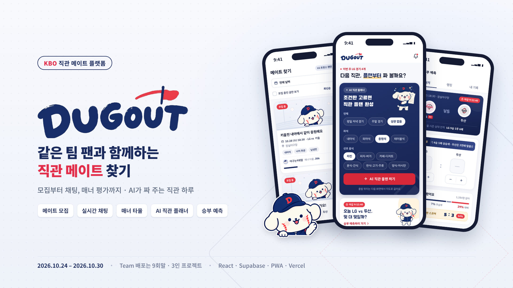
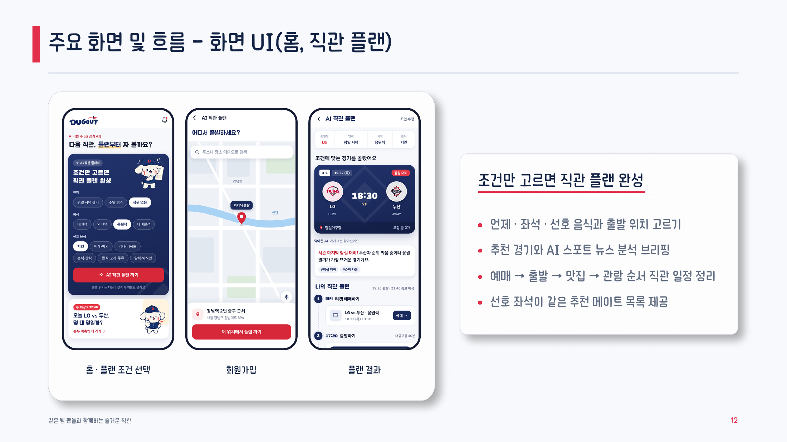
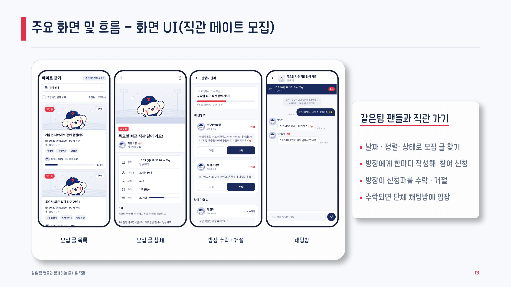
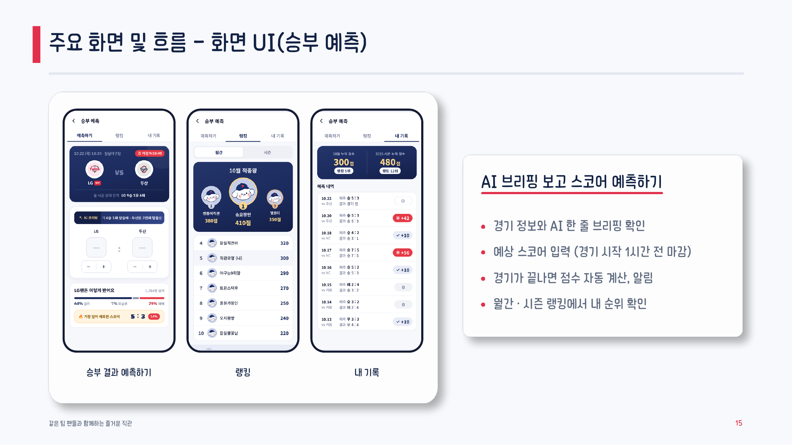

<a id="top"></a>



# ⚾ 오늘, 같이 응원할래? DUGOUT

- **구분**: 3인 팀 프로젝트 (프론트엔드 팀 프로젝트)
- **기간**: 2026년 10월 24일 ~ 2026년 10월 30일
- **배포**: <https://dugout-iota.vercel.app>

<details>
<summary><b>📑 Table of Contents</b></summary>

- [👤 팀원 (Team Members)](#team-members)
- [📌 프로젝트 개요 (Project Overview)](#project-overview)
- [🔍 주요 기능 (Key Features)](#key-features)
- [🧰 기술 스택 (Tech Stack)](#tech-stack)
- [🖥️ 개발 환경 (Software & Tools)](#software-tools)
- [🏗️ 서비스 아키텍처 (Service Architecture)](#service-architecture)
- [🖇 ERD (Entity Relationship Diagram)](#erd)
- [🧭 사용자 이용 흐름 (User Flow)](#user-flow)
- [🔐 주요 구현 포인트 (Key Implementation Points)](#key-implementation-points)
- [🖥️ 화면 설계 (UI)](#ui)
- [📽 프로젝트 시연 (Project Demo)](#project-demo)
- [📂 프로젝트 자료 (Documents)](#documents)

</details>

<a id="team-members"></a>
## 👤 팀원 (Team Members)
 
<table>
  <tr>
    <td align="center" width="280"><a href="https://github.com/pobingbin99"></a></td>
    <td align="center" width="280"><a href="https://github.com/vincecater1030"></a></td>
    <td align="center" width="280"><a href="https://github.com/Choonsik8999"></a></td>
  </tr>
  <tr>
    <td align="center" width="280"><a href="https://github.com/pobingbin99">이은진</a></td>
    <td align="center" width="280"><a href="https://github.com/vincecater1030">정형진</a></td>
    <td align="center" width="280"><a href="https://github.com/Choonsik8999">송재훈</a></td>
  </tr>
  <tr>
    <td align="center" width="280">팀장 · 회원 · 채팅 · DB · PWA</td>
    <td align="center" width="280">메이트 모집 · 승부 예측</td>
    <td align="center" width="280">홈 · AI 직관 플랜</td>
  </tr>
</table>

<details>
<summary>역할 상세</summary>

<table>
  <tr><th width="100">이름</th><th>담당</th></tr>
  <tr><td align="center" width="100">이은진</td><td>회원 · 채팅, Supabase DB · api 함수, 트리거 · pg_cron, PWA 푸시 알림 · 배포</td></tr>
  <tr><td align="center" width="100">정형진</td><td>모집 글 쓰기 · 목록 · 상세, 승부 예측 · 랭킹 · 내 기록, AI 승부 예측 브리핑</td></tr>
  <tr><td align="center" width="100">송재훈</td><td>홈 화면, AI 직관 플랜(조건 선택 · 경로 · 맛집 · 일정), KBO 경기 · 구장 데이터 수집</td></tr>
</table>

</details>

<a id="project-overview"></a>
## 📌 프로젝트 개요 (Project Overview)
 
**DUGOUT(덕아웃)** 은 같은 구단을 응원하는 팬들이 경기를 함께 관람할 수 있도록 돕는 **야구 팬 특화 플랫폼**입니다.<br>
경기별 모집 글로 응원 구단과 관람 성향이 맞는 메이트를 찾고, 수락되면 채팅방에서 함께 직관 약속을 잡을 수 있습니다.

주요 타겟은 최근 야구장에 새로 유입되어 직관을 함께할 사람을 찾는 **20~30대 관람객**입니다.<br>
모바일 앱으로 정보를 찾고 사람들과 교류하는 데 익숙한 세대인 만큼, 앱처럼 쓸 수 있는 **PWA**로 만들었습니다.

함께 간 메이트에게 남기는 **동행 후기**와 **매너 타율**로, 처음 만나는 상대도 믿고 직관을 함께할 수 있습니다.<br>
**AI 직관 플래너**는 조건에 맞는 경기를 추천하고, 이동 경로와 구장 맛집까지 이어 직관 하루를 준비해 줍니다.<br>
**승부 예측**에서는 같은 응원팀 팬끼리 경기 결과를 예측하고 순위를 겨루며 직관 전후의 재미를 더합니다.

<a id="key-features"></a>
## 🔍 주요 기능 (Key Features)

### ✅ 사용자 기능 (User Features)
 
#### 1. 덕아웃 입장하기 · 회원
- 이메일 · 닉네임 중복 확인 후 성별 · 나이대와 응원팀을 골라 가입해요.
- 로그인하면 내 응원팀 기준으로 경기와 메이트 모집 글이 보여요.
#### 2. AI 직관 플래너 · 홈
- 언제 · 좌석 · 음식 조건과 출발 위치를 고르면 AI가 추천 경기와 관전 포인트를 알려 줘요.
- 출발 → 맛집 → 관람 순서로 직관 하루 일정을 정리하고, 조건에 맞는 모임도 보여 줘요.
#### 3. 같이 갈 사람 찾기 · 메이트
- 같은 응원팀의 모집 글에 한마디와 함께 참여를 신청하고, 수락되면 채팅방에서 대화해요.
- 직접 모집 글을 쓰면 방장이 되어 신청자를 수락 · 거절하고 채팅방을 관리할 수 있어요.
#### 4. 오늘 경기 맞혀 보기 · 승부 예측
- 경기 정보와 AI 브리핑을 보고 경기 시작 1시간 전까지 예상 스코어를 입력해요.
- 경기가 끝나면 적중 여부에 따라 점수를 얻고, 월간 · 시즌 랭킹에서 내 순위를 확인해요.
#### 5. 내 약속 한곳에 · 내 직관
- 내가 연 약속과 참여한 약속을 한곳에 모아, 다가오는 직관과 지난 직관을 나눠 볼 수 있어요.
- 내가 방장인 약속에 새 참여 신청이 들어오면, 이곳에서 바로 확인하고 수락할 수 있어요.
#### 6. 매너로 쌓는 신뢰 · 마이페이지
- 직관이 끝나면 함께 간 메이트에게 1~10점 점수와 한 줄 후기를 익명으로 남겨요.
- 받은 점수는 매너 타율로 프로필에 쌓여, 다른 팬이 나를 믿고 함께할 수 있는 기준이 돼요.
  
### ✅ 시스템 기능 (System Features)
 
#### 경기 · 예측 자동화
- 일정 시간마다 KBO 경기 일정과 점수를 받아와 최신 결과를 자동으로 반영해요.
- 경기가 종료되면 승부 예측 점수를 자동으로 계산하고 랭킹에 바로 반영해요.

#### 알림 · 실시간
- 새 신청, 수락 · 거절, 승부 예측 결과를 앱이 닫혀 있어도 푸시 알림으로 알려 줘요.
- 채팅은 새로고침 없이 실시간으로 표시되고, 수락 · 나가기 등 소식도 채팅방에 안내돼요.

<a id="tech-stack"></a>
## 🧰 기술 스택 (Tech Stack)

### 🚀 Frontend
- React 19, Vite 8, React Router
- PWA (Web App Manifest · Service Worker · Web Push)
- 순수 CSS + 디자인 토큰(tokens.css)
- 카카오맵 API(출발 위치), ODsay API(대중교통 길찾기)

### 🔧 Backend (Serverless)
- Supabase
  - Auth (이메일 로그인 · JWT 세션)
  - Storage (모집 글 · 프로필 이미지)
  - Realtime (채팅)
  - Edge Functions (Deno · 외부 API 호출)
- AI · 외부 API
  - Claude Haiku (승부 예측 AI 브리핑)
  - NAVER 뉴스 검색 + Gemini (직관 플랜 관전 포인트)
  - API-Sports (KBO 경기 일정 · 결과)

### 🗄 Database
- PostgreSQL (Supabase)
  - RLS 정책, DB 트리거, RPC 함수(랭킹 · 승부 예측 집계)
  - pg_cron · pg_net (경기 결과 자동 갱신)

### ☁️ Deployment
- Vercel (GitHub 연동 · main 병합 시 자동 빌드 · 배포)
- Supabase (DB · 인증 · 스토리지 · Edge Functions)

<a id="software-tools"></a>
## 🖥️ 개발 환경 (Software & Tools)

- **개발 언어**: JavaScript, SQL, TypeScript(Edge Functions)
- **개발 도구**: IntelliJ IDEA, Supabase Dashboard
- **AI 도구**: Claude Design(화면 설계), Claude Code(개발)
- **협업 도구**: Git, GitHub(브랜치 · PR 템플릿), Notion

<a id="service-architecture"></a>
## 🏗️ 서비스 아키텍처 (Service Architecture)


<a id="erd"></a>
## 🖇 ERD (Entity Relationship Diagram)


<a id="user-flow"></a>
## 🧭 사용자 이용 흐름 (User Flow)


<a id="key-implementation-points"></a>
## 🔐 주요 구현 포인트 (Key Implementation Points)
 
### 1. 프론트엔드 데이터 흐름 · 화면 → 훅 → api
```
pages (화면)  →  hooks (useLoad)  →  src/api 함수  →  supabase-js (fetch)  →  { data, error }
```
- 모든 화면은 `src/api`에 정의한 함수만 호출하고, api 함수가 Supabase SDK로 REST 요청을 보내요.
- 응답에 `error`가 있으면 미리 정해 둔 한국어 메시지로 바꾸고, RLS에 막혀 0줄이 바뀐 경우도 실패로 처리해요.
- 조회는 공통 훅 `useLoad`가 감싸 **loading · ready · error · notfound** 네 가지 상태로 화면을 그려요.
- 변경 후에는 `refresh`로 조용히 다시 불러오고, 늦게 도착한 옛 응답은 버려 새 화면을 덮지 않게 했어요.
### 2. DB 단의 권한과 규칙 · RLS · 트리거
| 구분 | 내용 |
| --- | --- |
| **RLS** | 같은 응원팀 팬의 모집 글만 조회 · 방장만 신청자를 수락 · 거절 |
| **트리거** | 모집 글 작성 시 방장 자동 참여 · 정원이 차면 모집 마감 |
| **트리거** | 경기 종료 시 승부 예측 자동 채점 · 신청 · 수락 · 예측 결과 알림 발송 |
 
- 프론트에서 요청을 조작해도 DB가 권한과 규칙을 직접 검사해, 화면과 상관없이 항상 같은 기준으로 처리돼요.
### 3. PWA 푸시 알림 흐름
```
알림 허용 → 브라우저 구독 정보(endpoint · 키) → push_subscriptions 저장
 
신청 · 수락 · 예측 결과 → DB 트리거 → pg_net → send-push (Edge Function)
                                              → Web Push → Service Worker → 알림 표시
```
- **Web App Manifest**로 홈 화면에 추가하면 앱처럼 실행되고, **Service Worker**가 앱이 닫혀 있어도 알림을 띄워요.
- 서버는 저장해 둔 구독 정보로 **Web Push**를 보내요. (iOS는 홈 화면에 추가한 PWA에서 수신)
### 4. Edge Functions와 예약 작업
```
pg_cron (10분마다) → pg_net → Edge Function → API-Sports → games 테이블 저장
                                                        └─ 경기 종료 → 트리거 → 예측 채점 · 알림
```
| Edge Function | 역할 |
| --- | --- |
| 직관 플랜 관전 포인트 | NAVER 뉴스 검색 + Gemini로 경기 소개 문구 생성 |
| 승부 예측 AI 브리핑 | DB의 경기 기록을 넘겨 Claude Haiku가 브리핑 · 예상 스코어 생성 |
| 경기 결과 갱신 | API-Sports에서 KBO 경기 일정 · 점수를 받아 저장 |
| 푸시 발송 | 구독 정보로 Web Push 알림 전송 |
 
- AI · 외부 API 키는 브라우저에 두지 않고 **Edge Function Secrets**에만 저장해요.

<a id="ui"></a>
## 🖥️ 화면 설계 (UI)
 
#### 로그인 · 회원가입

 
#### 홈 · AI 직관 플랜

 
#### 직관 메이트 모집

 
#### 마이페이지 · 매너 평가

 
#### 승부 예측


<a id="project-demo"></a>
## 📽 프로젝트 시연 (Project Demo)
 
<p align="center">
  <a href="https://www.youtube.com/watch?v=uQPvetHl73E">
    
  </a>
  <br>
  ⚾ <b>DUGOUT 시연 영상 보러가기</b>
</p>

<a id="documents"></a>
## 📂 프로젝트 자료 (Documents)

- [🗣️ 발표 자료](./docs/DUGOUT_발표자료.pdf)

##### [⬆️ TOP](#top)
