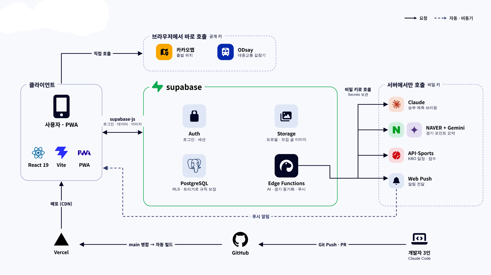
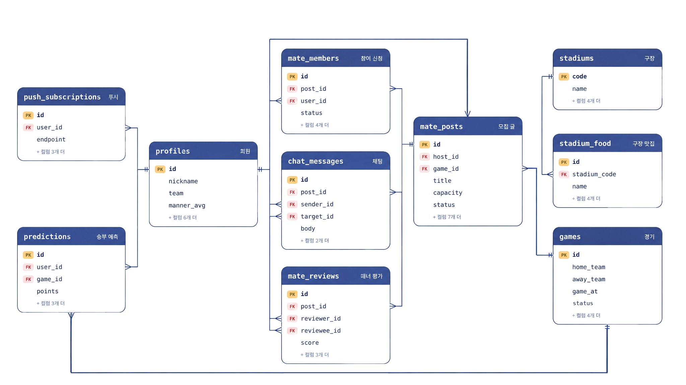
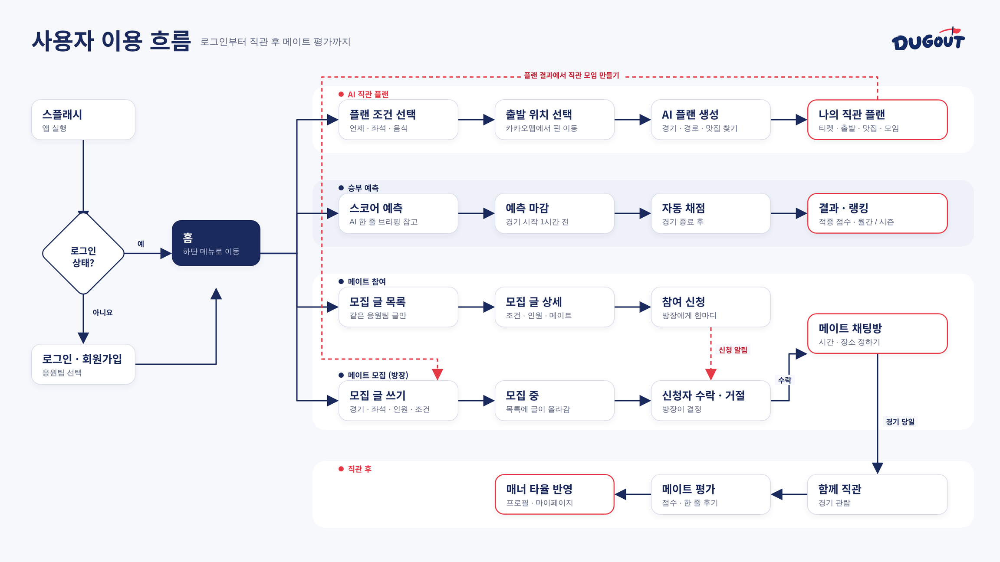
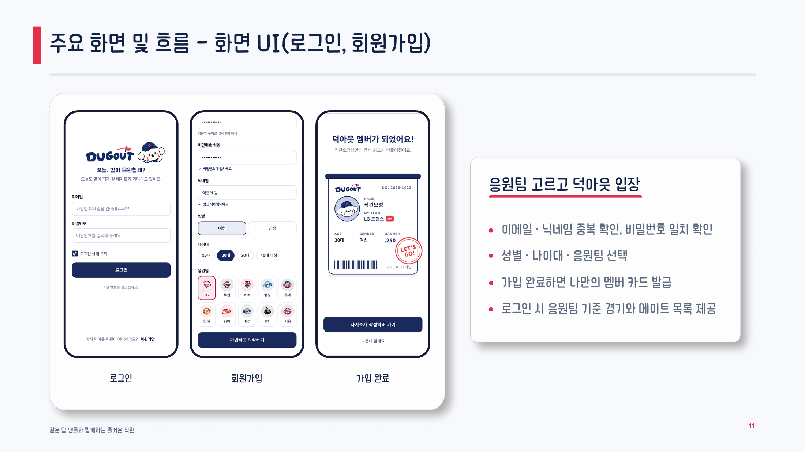
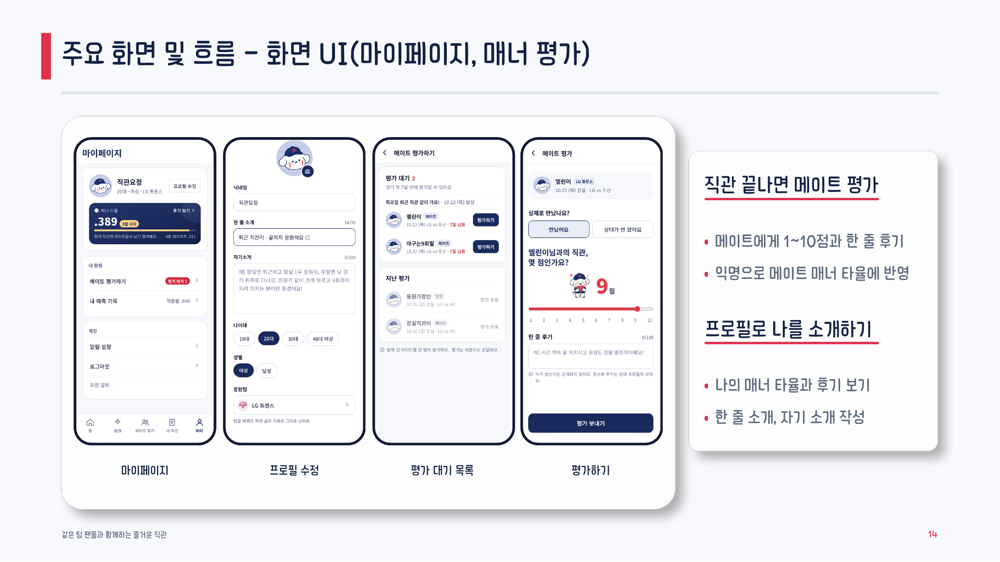

<a id="top"></a>

<!-- 대표 이미지: docs/images/cover.png 로 포트폴리오 대표 이미지(1500×1300)를 넣어 주세요 -->


# ⚾ 오늘, 같이 응원할래? DUGOUT

> **DUGOUT(덕아웃)** 은 같은 팀을 응원하는 야구 팬끼리 **직관 메이트를 찾고**, AI 플래너로 **직관 준비까지 한 번에** 끝내는 KBO 직관 메이트 매칭 서비스입니다.
> 앱 설치 없이 홈 화면에 추가하면 앱처럼 쓸 수 있는 **PWA**로 만들었습니다.

- **구분**: 3인 팀 프로젝트 (프론트엔드 팀 프로젝트 · 팀명 "배포는 9회말")
- **기간**: 2026년 10월 24일 ~ 2026년 10월 30일 (개발 5일 · 배포/영상 1일 · 발표 1일)
- **배포**: <https://배포-주소.vercel.app>  <!-- 실제 배포 주소로 바꿔 주세요 -->

**📑 Table of Contents**
- [👤 팀원 (Team Members)](#team-members)
- [📌 프로젝트 개요 (Project Overview)](#project-overview)
- [🔍 주요 기능 (Key Features)](#key-features)
- [🧰 기술 스택 (Tech Stack)](#tech-stack)
- [🖥️ 개발 환경 (Software & Tools)](#software-tools)
- [🏗️ 서비스 아키텍처 (Service Architecture)](#service-architecture)
- [🖇 ERD (Entity Relationship Diagram)](#erd)
- [🧭 사용자 이용 흐름 (User Flow)](#user-flow)
- [🔐 주요 구현 포인트 (Key Implementation Points)](#key-implementation-points)
- [🖥️ 화면 설계 (UI)](#ui)
- [📽 프로젝트 시연 (Project Demo)](#project-demo)
- [📂 프로젝트 자료 (Documents)](#documents)

<a id="team-members"></a>
## 👤 팀원 (Team Members)

|  |  |  |
| :---: | :---: | :---: |
| [이은진](https://github.com/pobingbin99) | [정형진](https://github.com/정형진-깃허브ID) | [송재훈](https://github.com/송재훈-깃허브ID) |
| 팀장 · 회원 · 채팅 · DB · PWA | 메이트 모집 · 승부 예측 | 홈 · AI 직관 플랜 |

<details>
<summary>역할 상세</summary>

| 이름 | 담당 |
| --- | --- |
| 이은진 | 회원가입 · 로그인 · 마이페이지 · 매너 평가 · 채팅방(Realtime), Supabase DB 설계와 api 함수, DB 트리거 · pg_cron, PWA · 푸시 알림, Vercel 배포 |
| 정형진 | 모집 글 쓰기 · 목록 · 상세, 승부 예측 · 랭킹 · 기록, AI 승부 예측 브리핑 |
| 송재훈 | 홈 화면, AI 직관 플랜 전체(조건 선택 → 경로 · 맛집 · 관람 일정), KBO 경기 · 구장 맛집 데이터 수집 |

</details>

<a id="project-overview"></a>
## 📌 프로젝트 개요 (Project Overview)

야구장에서 팬들이 만나 소개팅하는 예능 **'원수는 외야석에서'** 를 보고, 처음에는 야구를 공통 관심사로 한 소개팅 앱을 떠올렸습니다.
그런데 이야기를 나눠 보니, 소개팅보다 먼저 필요한 건 **같은 팀을 응원하는 직관 친구**였습니다. 그래서 서비스의 방향을 **'직관 메이트 찾기'** 로 바꿨습니다.

타겟은 최근 야구장에 새로 유입된 **2030 팬**입니다. 카페나 게시판보다 모바일 앱으로 정보를 찾고 사람을 만나는 데 익숙한 세대에 맞춰,

- **같은 응원팀 팬끼리만** 연결하고
- 모집 → 신청 → 수락 → 채팅 → 후기로 이어지는 흐름에 **매너 타율**로 신뢰를 더하고
- **AI 직관 플래너**와 **승부 예측**으로 직관 전후의 재미까지 한곳에 담았습니다.

> **벤치마킹** · 당근(친근한 UI, 모집 → 신청 → 채팅 흐름) · 구단 공식 앱(경기 일정 · 결과)
> 덕아웃은 지역 대신 **구단과 경기**를 기준으로 사람을 잇고, 경기 정보를 **모집 · 맛집 · 경로**와 연결했습니다.

<a id="key-features"></a>
## 🔍 주요 기능 (Key Features)

### ✅ 사용자 기능 (User Features)

- **덕아웃 입장 (회원)**
  → 이메일 인증 회원가입, 이메일 · 닉네임 중복 확인, 성별 · 나이대 · 응원팀 선택
  → 가입하면 나만의 멤버 카드 발급, 로그인하면 내 응원팀 기준으로 경기와 메이트가 보여요
- **AI 직관 플래너**
  → 언제 · 좌석 · 선호 음식 · 출발 위치(카카오맵)만 고르면 추천 경기와 AI 관전 포인트 브리핑 제공
  → 예매 → 출발(ODsay 길찾기) → 맛집 → 관람 순서의 직관 하루 일정 정리, 선호 좌석이 같은 추천 메이트
- **메이트 찾기 · 모집**
  → 날짜 · 정렬 · 모집 상태로 같은 팀 모집 글 찾기, 방장에게 한마디 남겨 참여 신청
  → 방장이 신청자를 수락 · 거절하고, 수락되면 단체 채팅방(실시간)에 입장
  → 정원이 차면 자동으로 모집 마감
- **승부 예측**
  → AI 한 줄 브리핑을 보고 스코어 예측 (경기 시작 1시간 전 마감)
  → 경기가 끝나면 자동 채점, 월간 · 시즌 랭킹과 내 기록 확인
- **내 직관 · 마이페이지**
  → 내 직관 약속과 새 신청을 한눈에 확인
  → 프로필(한 줄 소개 · 자기소개 · 응원팀) 수정, 받은 매너 후기 확인
- **매너 타율**
  → 직관이 끝나면 함께 간 메이트에게 1~10점과 한 줄 후기를 익명으로 남기고, 점수는 상대의 매너 타율(할푼리)에 반영

### ✅ 시스템 기능 (System Features)

- **KBO 경기 자동 갱신** → pg_cron이 10분마다 Edge Function을 호출해 API-Sports의 경기 일정 · 점수를 저장
- **DB 트리거 자동 처리** → 방장 자동 참여, 정원 마감, 경기 종료 시 예측 자동 채점, 알림 발송
- **푸시 알림 (PWA)** → 새 신청 · 수락 · 거절 · 예측 적중 소식을 앱이 닫혀 있어도 알림으로 전달
- **응원팀별 노출 제한 (RLS)** → 같은 응원팀 팬의 글만 보이도록 DB에서 권한 검사

<a id="tech-stack"></a>
## 🧰 기술 스택 (Tech Stack)

### 🚀 Frontend
- React 19, Vite 8, React Router
- PWA (Web App Manifest · Service Worker · Web Push)
- 순수 CSS + 디자인 토큰(tokens.css)
- 카카오맵 API(출발 위치), ODsay API(대중교통 길찾기)

### 🔧 Backend (Serverless)
- Supabase
  - Auth (이메일 로그인 · JWT 세션)
  - Storage (모집 글 · 프로필 이미지)
  - Realtime (채팅)
  - Edge Functions (Deno · 비밀 키가 필요한 외부 API 호출)
- AI · 외부 API: Claude Haiku(승부 예측 브리핑), NAVER 뉴스 검색 + Gemini(직관 플랜 관전 포인트), API-Sports(KBO 경기 데이터)

### 🗄 Database
- PostgreSQL (Supabase)
  - RLS 정책, DB 트리거, RPC 함수(랭킹 · 팬 예측 집계)
  - pg_cron · pg_net (경기 결과 자동 갱신)

### ☁️ Deployment
- Vercel (GitHub 연동 · main 병합 시 자동 빌드 · 배포)
- Supabase (DB · 인증 · 스토리지 · Edge Functions)

<a id="software-tools"></a>
## 🖥️ 개발 환경 (Software & Tools)

- **개발 언어**: JavaScript, SQL, TypeScript(Edge Functions)
- **개발 도구**: IntelliJ IDEA, Supabase Dashboard
- **AI 도구**: ChatGPT(브랜딩 · 무드보드), Claude Design(화면 설계), Claude Code + CLAUDE.md(개발)
- **협업 도구**: Git, GitHub(브랜치 · PR 템플릿), Notion

<a id="service-architecture"></a>
## 🏗️ 서비스 아키텍처 (Service Architecture)



<a id="erd"></a>
## 🖇 ERD (Entity Relationship Diagram)



<a id="user-flow"></a>
## 🧭 사용자 이용 흐름 (User Flow)



<a id="key-implementation-points"></a>
## 🔐 주요 구현 포인트 (Key Implementation Points)

### 🔁 화면 → 훅 → api → Supabase
```
pages (화면)  →  hooks (useLoad)  →  src/api 함수  →  supabase-js (fetch)  →  { data, error }
```
- 모든 화면은 `src/api`에 정의한 함수만 호출하고, api 함수가 Supabase SDK로 REST 요청을 보냅니다.
- `error`가 있으면 미리 정의한 한국어 메시지로 바꿔 던지고, RLS에 막혀 **0줄이 바뀐 경우**도 실패로 처리했습니다.

### 🧩 공통 상태 관리 훅 `useLoad`
| 상태 | 의미 | 화면 |
| --- | --- | --- |
| `loading` | 불러오는 중 | 로딩 화면 |
| `ready` | 데이터 도착 | 내용 표시 |
| `notfound` | 데이터 없음 | 빈 화면 |
| `error` | 실패 | 오류 화면 · 다시 시도 |

- `reload`는 로딩 화면을 보여 주고, `refresh`는 화면을 둔 채 조용히 다시 불러옵니다. (수락 같은 변경 뒤에는 `refresh`)
- 화면을 떠나거나 조건이 바뀌면 `stale` 처리해, 늦게 도착한 옛 응답이 새 화면을 덮지 않게 했습니다.

### ⚾ 경기 결과 자동 갱신 → 채점 → 알림
```
pg_cron (10분마다) → pg_net → Edge Function → API-Sports → games 저장
                                                     └─ 경기 종료 → DB 트리거 → 예측 자동 채점 → 푸시 알림
```

<a id="ui"></a>
## 🖥️ 화면 설계 (UI)

| 로그인 · 회원가입 | 홈 · AI 직관 플랜 |
| :---: | :---: |
|  |  |
| **직관 메이트 모집** | **마이페이지 · 매너 평가** |
|  |  |
| **승부 예측** | |
|  | |

<a id="project-demo"></a>
## 📽 프로젝트 시연 (Project Demo)

<!-- 유튜브 영상 ID만 바꾸면 썸네일과 링크가 함께 바뀌어요 -->
[](https://youtu.be/유튜브영상ID)

⚾ **[DUGOUT 시연 영상 보러가기](https://youtu.be/유튜브영상ID)**

<a id="documents"></a>
## 📂 프로젝트 자료 (Documents)

- [🗣️ 발표 자료](./docs/DUGOUT_발표자료.pdf)

##### [⬆️ TOP](#top)
